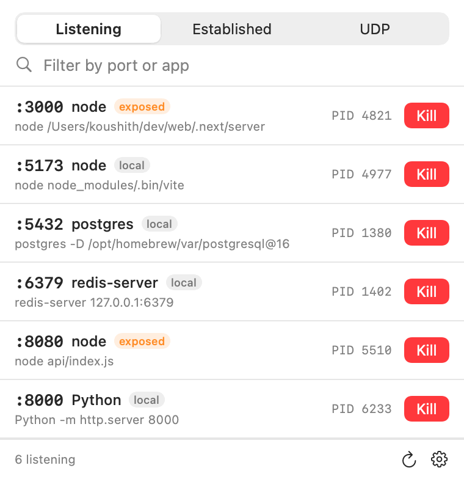
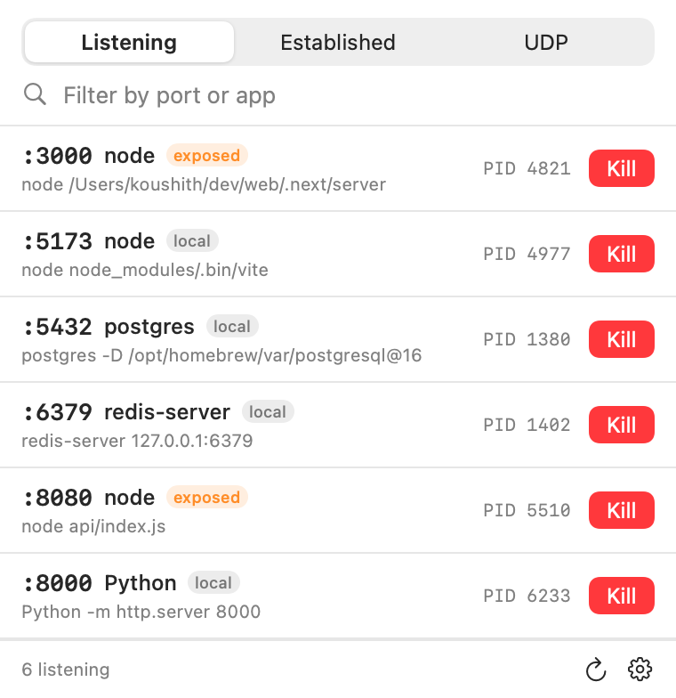
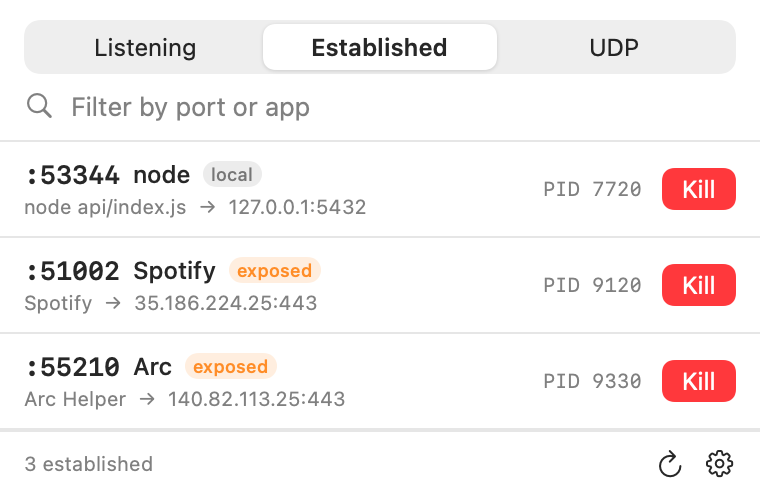

# PortTray

a tiny macOS menu bar app that shows which ports are open, what app is using them, and lets you kill that process right from the tray. no dock icon, no window, just a thing that sits up top.



| listening | established |
| --- | --- |
|  |  |

## why i built this

i usually have a few projects running at once, so ports get taken. when i start a server and hit "address already in use", i used to run `lsof -i :3000`, find the pid, `kill -9` it, and repeat for the next port.

PortTray just puts that in the menu bar. it shows what is listening, which app it is, and lets me kill it in one click.

## download

grab the latest `PortTray.app.zip` from [Releases](../../releases/latest), unzip it, and drop it in `/Applications`.

it's not signed with a paid apple cert, so the first launch gets blocked by gatekeeper. get past it once:

- right click the app, then click Open, then Open again in the dialog

or from terminal:

```
xattr -dr com.apple.quarantine /Applications/PortTray.app
```

after that it just opens normally.

## what it does

- lists open ports with the owning app and PID
- shows the full command line under each row, so "node" becomes "node /Users/me/project/server.js" and you actually know which one it is
- switch between Listening (TCP), Established, and UDP
- filter by port number or app name
- one Kill button per row. it asks once, sends SIGTERM so the app can clean up, then escalates to SIGKILL on its own if the process is still hanging around. no menu of signals to pick from
- right click a row for Open in Browser (local web ports) and copy PID / port / address / command
- each row is tagged `local` (loopback only) or `exposed` (reachable from the network), so you can spot something listening on all interfaces at a glance
- live count badge next to the menu bar icon, always the listening count so the tray does not jump around when you switch tabs
- Open at Login toggle in the gear menu
- auto refreshes every few seconds

killing a process owned by another user fails with a permission notice. that needs sudo, which this app does not do on purpose.

## build it yourself

needs the swift toolchain (comes with xcode).

```
git clone https://github.com/Koushith/porttray.git
cd porttray
./build.sh
open PortTray.app
```

`build.sh` compiles a release binary, assembles `PortTray.app`, and ad-hoc signs it so it runs locally.

## notes

- Open at Login registers from wherever the app currently lives, so move it to `/Applications` before turning it on. otherwise macOS may not relaunch it after a reboot.
- everything is read from `lsof` and processes are signalled with `/bin/kill`. no kernel extensions, no elevated privileges, around 1 to 2 MB, zero runtime dependencies.

## how it's built

swift, AppKit `NSStatusItem` + `NSPopover`, SwiftUI for the popover content.

```
Sources/PortTray/
  PortTrayApp.swift    app entry
  AppDelegate.swift    status item, popover, count badge
  PortListView.swift   popover UI and rows
  PortStore.swift      observable state and scan mode
  PortScanner.swift    lsof scan and kill
  LoginItem.swift      SMAppService launch at login
  MenuBarIcon.swift    custom template menu bar glyph
  Models.swift         PortEntry, ScanMode, Exposure
  ShotView.swift       static UI replica used for screenshots
  ScreenshotMaker.swift  renders media/ via --shots (ImageRenderer)
```

the screenshots and the gif in this readme are rendered straight from the real
SwiftUI views with `PortTray --shots <dir>`, no screen recording involved.
