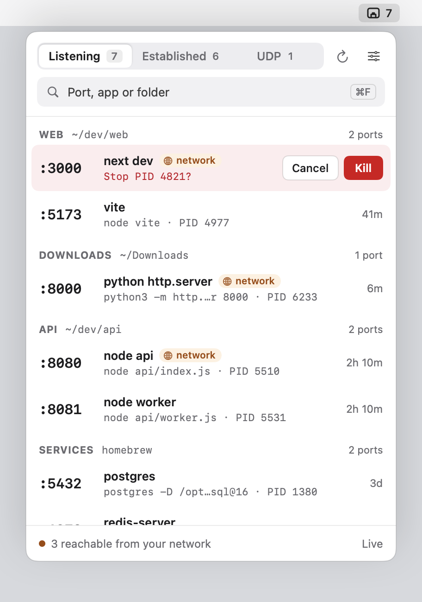
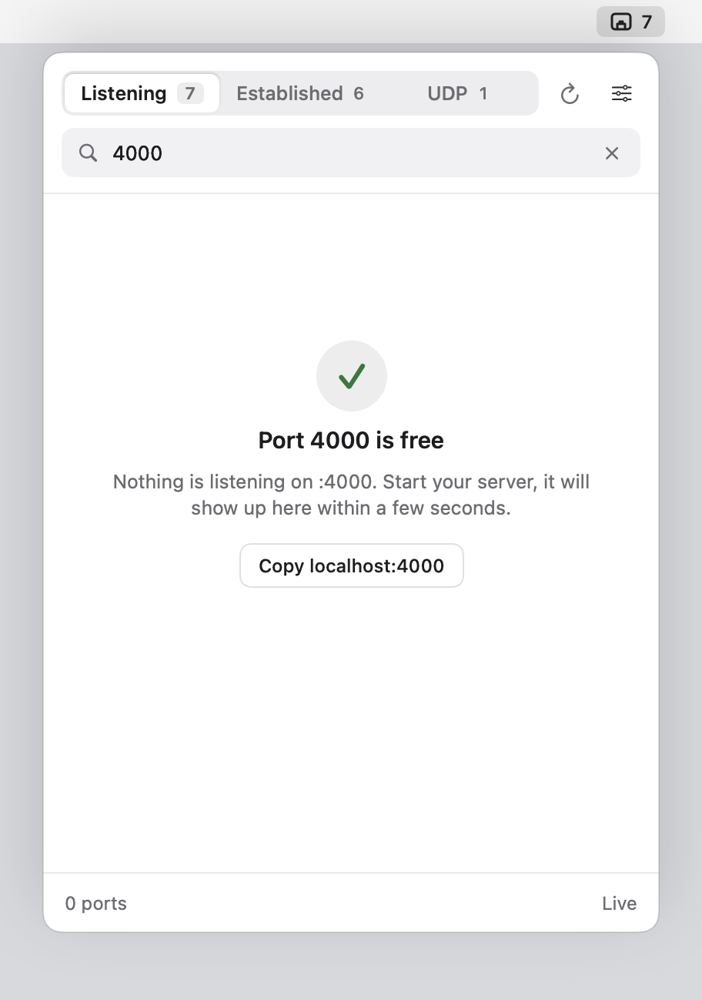
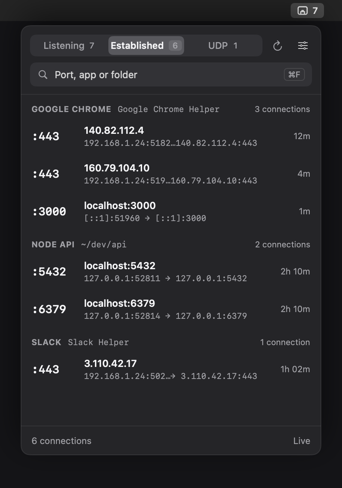

# PortTray

a tiny macOS menu bar app that shows which ports are open, what app is using them, and lets you kill that process right from the tray. no dock icon, no window, just a thing that sits up top.


| listening, grouped by project | kill, confirmed inline |
| --- | --- |
|  |  |

| search a port, see that it's free | established, dark mode |
| --- | --- |
|  |  |

## why i built this

i usually have a few projects running at once, so ports get taken. when i start a server and hit "address already in use", i used to run `lsof -i :3000`, find the pid, `kill -9` it, and repeat for the next port.

PortTray just puts that in the menu bar. it shows what is listening, which project it belongs to, and the command behind it, so a row is not just "node" but "next dev in ~/dev/web". then you kill it in one click.

## download

grab the latest `PortTray.app.zip` from [Releases](../../releases/latest), unzip it, and drop it in `/Applications`.

it's not signed with a paid apple cert, so the first launch gets blocked by gatekeeper. get past it once:

- right click the app, then click Open, then Open again in the dialog

or from terminal:

```
xattr -dr com.apple.quarantine /Applications/PortTray.app
```

after that it just opens normally.

## what it does

- lists open ports grouped by the **project folder** they were started from (`web ~/dev/web`, `api ~/dev/api`), then homebrew services, apps, and macOS itself
- friendly names: `next dev`, `vite`, `node api`, `python http.server` instead of a wall of `node`
- uptime on every row, so you can spot the server you forgot about three days ago
- Listening, Established, and UDP tabs, each with a live count
- hover a row to get Kill. it confirms inline (Enter to kill, Esc to back out), sends SIGTERM so the app can clean up, then SIGKILL if it is still hanging around
- type a port number into search: if nothing is on it you get "Port 4000 is free" and a button to copy `localhost:4000`
- an orange `network` tag on anything reachable from your network, plus a count in the footer
- right click a row for Open in Browser, Reveal Folder in Finder, and copy port / PID / address / command
- keyboard: ⌘F search, ⌘R refresh, ⌘1 ⌘2 ⌘3 switch tabs
- listening count badge next to the menu bar icon
- light and dark mode, Open at Login, all in a 400pt popover

killing a process owned by another user fails with a permission notice. that needs sudo, which this app does not do on purpose.

## what's new in v2

a full redesign plus a rewrite of the scanning, mostly to stop it eating battery.

**design**

- new popover: segmented tabs with counts, project grouping, friendly names, uptime, hover to kill, inline confirm, "port is free" search, toast after a kill, new menu bar icon
- small animations everywhere it helps: the tab pill slides, rows fade in and out as ports open and close, the confirm buttons slide in, the free port check pops. they only run when something changes, nothing loops in the background

**battery and speed**

v1 had a 3 second refresh timer that kept running forever once you had opened the popover once, even after closing it. every tick spawned `lsof` and `ps`, plus another `lsof` every 5 seconds for the badge, all on the main thread. that's where the battery went.

| | v1 | v2 |
| --- | --- | --- |
| how ports are read | spawn `lsof` + `ps`, parse text | read the kernel socket table directly via `libproc`, in process |
| child processes | 2-3 per refresh | 0 |
| one full refresh (all 3 tabs) | ~60 ms of subprocess work | ~2 ms |
| popover closed | `lsof` every 5s, plus the 3s timer if it had ever been opened | one ~1 ms badge check every ~15s, batched with other timers |
| screen asleep or locked | kept scanning | stops completely |
| main thread | did the scanning | only draws; scans run in the background at low priority |
| redraws | every refresh | only when something actually changed |
| kill | `/bin/kill` + a fixed 0.4s block on the UI | direct signal, checks every 50ms, UI never blocks |

process names, working folders and command lines are cached per PID, and the scan buffers are reused, so a refresh allocates almost nothing.

## build it yourself

needs the swift toolchain (comes with xcode).

```
git clone https://github.com/Koushith/porttray.git
cd porttray
./build.sh
open PortTray.app
```

`build.sh` compiles a release binary, assembles `PortTray.app`, and ad-hoc signs it so it runs locally.

## notes

- Open at Login registers from wherever the app currently lives, so move it to `/Applications` before turning it on. otherwise macOS may not relaunch it after a reboot.
- ports are read with `libproc` (`proc_pidinfo` / `proc_pidfdinfo`), the same kernel api `lsof` uses, and processes are signalled with `kill(2)`. no kernel extensions, no elevated privileges, zero runtime dependencies. like plain `lsof`, it can only see processes owned by you.
- with the popover closed the badge can lag up to ~20 seconds behind reality. opening the popover refreshes instantly.
- established connections show IPs, not hostnames. a reverse dns lookup per connection would cost network requests, which is the opposite of the point.

## how it's built

swift, AppKit `NSStatusItem` + `NSPopover`, SwiftUI for the popover content.

```
Sources/PortTray/
  PortTrayApp.swift      app entry
  AppDelegate.swift      status item, popover, timers, sleep / wake handling
  PortListView.swift     popover UI, rows, animations
  Theme.swift            colors (light + dark) and motion
  PortStore.swift        observable state, background refresh, kill, toasts
  PortScanner.swift      libproc socket scan, process info cache, kill
  Presenter.swift        grouping, friendly names, uptime (runs off the main thread)
  Models.swift           PortEntry, PortRow, PortGroup, ScanMode
  LoginItem.swift        SMAppService launch at login
  MenuBarIcon.swift      template menu bar glyph
  ScreenshotMaker.swift  renders media/ via --shots
```

the screenshots and the gif in this readme are rendered straight from the real
SwiftUI views with demo data via `PortTray --shots <dir>`, no screen recording involved.
